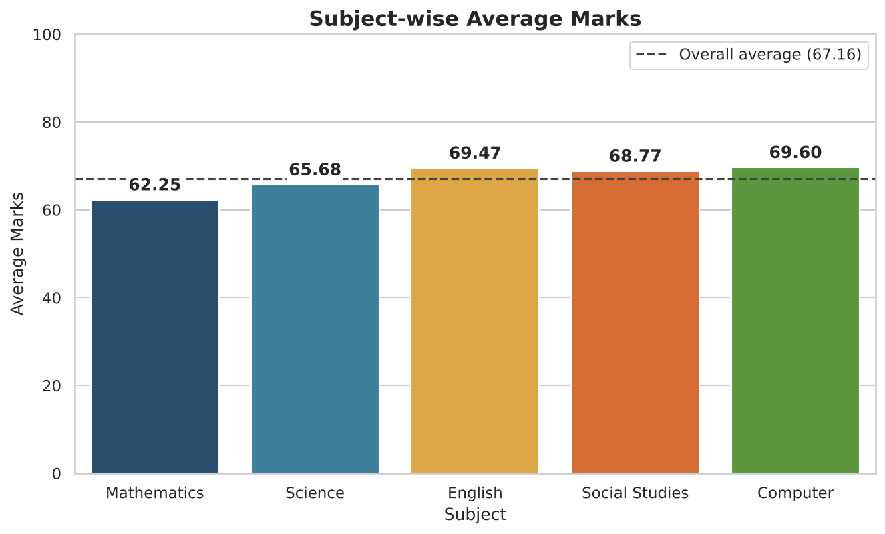
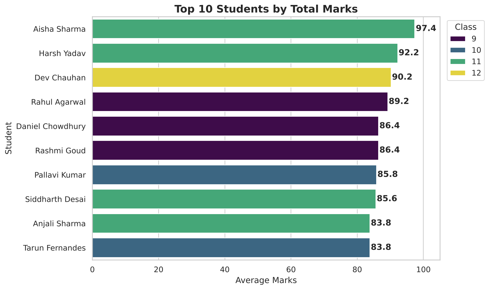
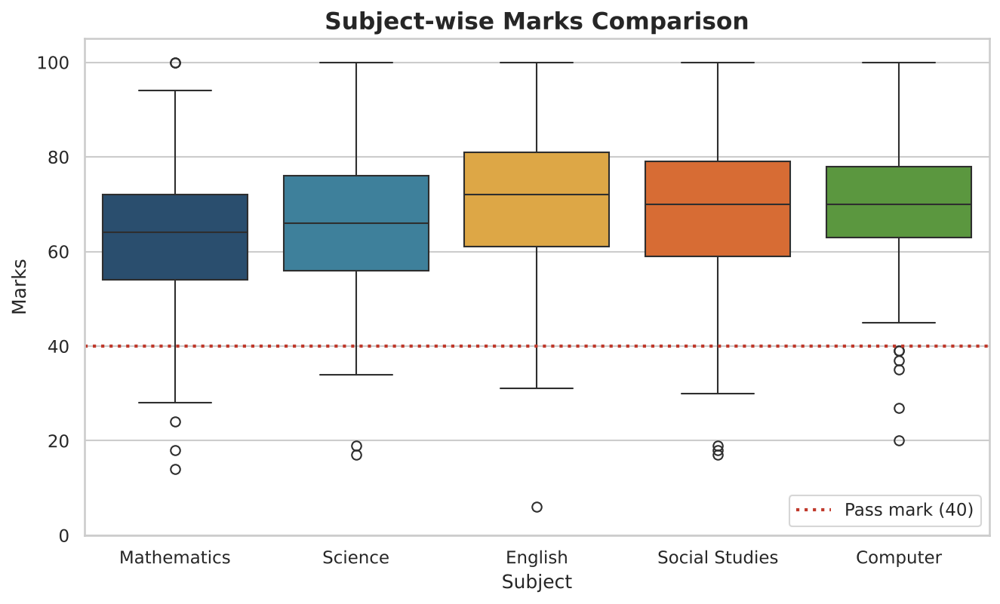

# Student Performance Analysis

An end-to-end, beginner-friendly **Data Analyst portfolio project** built with **Python, Pandas, NumPy, Matplotlib, Seaborn, Excel and Jupyter Notebook**.

The project takes a raw (and deliberately messy) student marks dataset, cleans it, analyses student / subject / gender / class performance, creates six professional charts and exports a formatted multi-sheet Excel report.

---

## Project Description

A school wants to understand how its students are performing. This project answers questions such as:

- Who are the top-performing students, and who failed?
- Which subject is the strongest and which is the weakest?
- What is the overall pass percentage?
- Do results differ by gender or class?

The raw dataset contains realistic data-quality problems (missing marks, duplicates, impossible marks, invalid records), so the cleaning stage is a real part of the project rather than a formality.

## Project Objectives

1. Calculate the average marks of each student.
2. Find the highest and lowest marks.
3. Calculate the overall pass percentage.
4. Compare subject-wise results.
5. Identify top-performing students.
6. Identify students who failed.
7. Calculate subject-wise average marks.
8. Find the highest-performing subject.
9. Find the lowest-performing subject.
10. Create a final student performance summary.

## Technologies Used

| Tool | Purpose |
|------|---------|
| Python 3.10+ | Programming language |
| Pandas | Data cleaning and analysis |
| NumPy | Numerical operations |
| Matplotlib | Charts |
| Seaborn | Statistical charts and styling |
| openpyxl (with Pandas) | Excel report and formatting |
| Jupyter Notebook | Step-by-step analysis with outputs |

## Dataset Information

**File:** `data/student_performance.csv` (123 raw rows, 10 columns, reproducible with a fixed random seed)

| Column | Description |
|--------|-------------|
| `Student_ID` | Unique ID (S001, S002, ...) |
| `Student_Name` | Student's full name |
| `Gender` | Male / Female |
| `Age` | Age in years |
| `Class` | 9, 10, 11 or 12 |
| `Mathematics`, `Science`, `English`, `Social_Studies`, `Computer` | Marks out of 100 |

**Pass rule used in this project:** a student passes only if they score **at least 40 in every subject**. Grades are based on the average marks (A+ 90+, A 80+, B 70+, C 60+, D 50+, E 40+, F below 40); a student who fails any subject gets grade F.

**Deliberate data problems in the raw file** (so the cleaning step has real work to do):

- 6 blank marks, 1 blank age, 1 text entry (`AB`) typed instead of a mark
- 3 impossible marks (`105`, `-5`, `150`)
- 3 exact duplicate rows
- 2 invalid records (one student with no name, one with age 45)

## Project Folder Structure

```
Student_Performance_Analysis/
│
├── data/
│   ├── student_performance.csv             <- raw dataset (123 rows)
│   └── cleaned_student_performance.csv     <- cleaned dataset (118 rows)
│
├── notebooks/
│   └── student_performance_analysis.ipynb  <- step-by-step analysis with outputs
│
├── outputs/
│   ├── charts/                             <- 6 PNG charts
│   └── student_performance_report.xlsx     <- formatted Excel report (5 sheets)
│
├── src/
│   ├── analysis.py                         <- full pipeline: clean -> analyse -> charts -> Excel
│   └── generate_dataset.py                 <- (optional) re-creates the sample CSV
│
├── requirements.txt
├── README.md
└── .gitignore
```

## Installation Instructions

You need **Python 3.10 or newer** ([python.org](https://www.python.org/downloads/)). On Windows, tick *"Add Python to PATH"* during installation.

Open **Command Prompt** (or PowerShell) in the project folder and run:

```bash
# 1. Create a virtual environment (recommended)
python -m venv venv

# 2. Activate it
venv\Scripts\activate

# 3. Install the libraries
pip install -r requirements.txt
```

<details>
<summary>macOS / Linux commands</summary>

```bash
python3 -m venv venv
source venv/bin/activate
pip install -r requirements.txt
```
</details>

## How to Run the Project

**Option 1 - Python script (one command, creates everything):**

```bash
python src\analysis.py
```

This cleans the data, prints the analysis, saves the charts to `outputs/charts/` and creates `outputs/student_performance_report.xlsx`.

**Option 2 - Jupyter Notebook (step by step):**

```bash
jupyter notebook notebooks\student_performance_analysis.ipynb
```

Then choose **Run -> Run All Cells**. The notebook uses the same code as the script and already contains saved outputs, so you can also just read it.

**Optional - recreate the raw dataset:**

```bash
python src\generate_dataset.py
```

> **Tip:** if the script says it could not save the Excel report, close `student_performance_report.xlsx` in Excel and run it again (Windows locks open files).

## Data Cleaning Steps

| # | Step | What was found | Action |
|---|------|----------------|--------|
| 1 | Check data types | `Social_Studies` was read as text because of an `AB` entry; `Age` was a decimal | Converted marks and age to numbers (`AB` became missing) |
| 2 | Check missing values | 9 missing cells in 7 columns | Reported per column |
| 3 | Check and remove duplicates | 3 duplicate rows, 0 repeated Student_IDs | Removed (123 -> 120 rows) |
| 4 | Check invalid student records | 1 record without a name, 1 record with age 45 | Removed (120 -> 118 rows) |
| 5 | Validate marks (0-100) | 3 impossible marks: 105, -5, 150 | Set to missing |
| 6 | Handle missing values | 10 missing marks, 1 missing age | Marks filled with the subject **median**; age filled with the class median |
| 7 | Final checks | 0 missing values, 0 duplicates, marks between 6 and 100 | Saved `cleaned_student_performance.csv` |

## Exploratory Data Analysis (EDA) Performed

- Total number of students, overall average, maximum and minimum marks (and who scored them)
- Average, highest and lowest marks for every student
- Subject-wise average, highest, lowest, median, standard deviation, pass count and pass percentage
- Highest- and lowest-performing subject
- Gender-wise and class-wise performance
- Pass and fail counts, overall pass percentage, pass percentage by gender and class
- List of failed students with the subjects they failed
- Top 10 students by total marks
- Grades and ranks for every student

## Visualizations

| Chart | File |
|-------|------|
| Subject-wise average marks (bar) | `01_subject_wise_average_marks.png` |
| Student performance distribution (histogram) | `02_performance_distribution.png` |
| Pass vs Fail (pie) | `03_pass_vs_fail.png` |
| Gender-wise performance (bar) | `04_gender_wise_performance.png` |
| Top 10 students (bar) | `05_top_10_students.png` |
| Subject-wise comparison (box plot) | `06_subject_wise_boxplot.png` |







## Key Findings and Insights

| Metric | Result |
|--------|--------|
| Total students (after cleaning) | **118** |
| Overall average marks | **67.16** |
| Highest / lowest single mark | **100** (Aisha Sharma, Mathematics) / **6** (Mary Menon, English) |
| Passed / Failed | **102 / 16** |
| Overall pass percentage | **86.44 %** |
| Highest-performing subject | **Computer** (average 69.60) |
| Lowest-performing subject | **Mathematics** (average 62.25) |
| Top student | **Aisha Sharma**, Class 11 (average 97.4) |

**Insights**

- **Mathematics needs attention.** It has the lowest average (62.25), the most failures (12 students), and 4 of the 6 students who failed in only one subject failed in Mathematics.
- **Subject averages are close together** (62.25 to 69.60), so no subject is dramatically stronger than the rest apart from Mathematics being the weakest.
- **Female students scored slightly higher** than male students on average (68.36 vs 65.78) and had a higher pass percentage (88.89 % vs 83.64 %). Female students led in every subject.
- **Class 9 has the best pass percentage (90.62 %)**, while **Class 12 has the lowest average (64.19) and pass percentage (82.14 %)**.
- **Only 3 students reached grade A+**, and the top student is clearly ahead of the group (97.4 vs 92.2 for second place).
- **5 students failed in 4 or 5 subjects.** These students likely need urgent academic support, while the students who failed in one subject need targeted help.

> The data is synthetic (randomly generated), so these findings demonstrate the analysis method and are not real school results. Differences between genders or classes are small and based on small groups, so they should not be treated as statistically significant.

## Output Files

| File | Description |
|------|-------------|
| `data/cleaned_student_performance.csv` | Cleaned dataset (118 students) |
| `outputs/charts/*.png` | 6 charts |
| `outputs/student_performance_report.xlsx` | Excel report with 5 sheets |

**Excel sheets:**

1. **Cleaned_Data** - the cleaned dataset
2. **Student_Summary** - every student with total, average, highest / lowest mark and subject, result, grade and rank
3. **Subject_Analysis** - subject-wise statistics, ranking and pass percentage
4. **Pass_Fail_Analysis** - overall pass / fail summary, by gender, by class, and the list of failed students
5. **Top_Students** - top 10 students with all subject marks

## Future Improvements

- Add a Power BI or Tableau dashboard built from the Excel report
- Add trend analysis across several exams or terms
- Use real (anonymised) school data
- Add statistical tests (for example, a t-test for the gender difference)
- Predict at-risk students with a simple machine learning model
- Add a Streamlit web app so teachers can upload a CSV and get the report instantly
- Add unit tests for the cleaning steps

---

*Built as a portfolio project to demonstrate data cleaning, exploratory data analysis, visualization and reporting with Python.*
